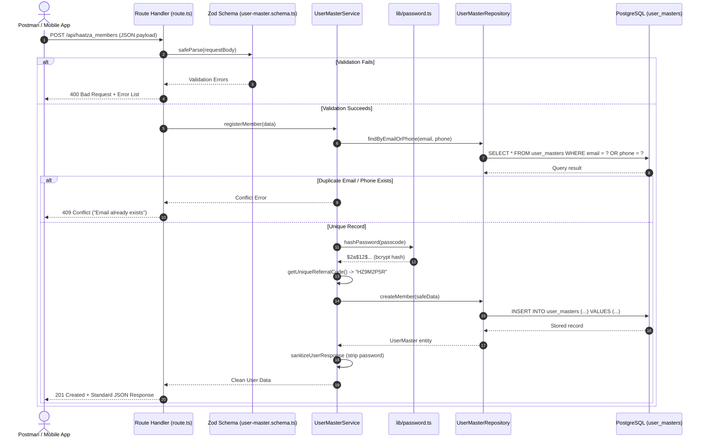

# Haatza Backend - Beginner-Friendly Learning & Architecture Guide

Welcome! This guide is written specifically for you as you learn backend development. After reading this guide, you will be able to confidently explain every file, design pattern, and concept in this project to your sir or project manager during a technical review.

---

## 1. Core Concepts Explained Simply

### What is a Route Handler? (`app/api/.../route.ts`)
A **Route Handler** is the "front door" of an API. When a mobile app or Postman sends an HTTP request (like `POST /api/haatza_members`), Next.js looks inside `app/api/haatza_members/route.ts` to find the matching function (such as `export async function POST(request)`).
- **Its job:** Accept the incoming request, check if the JSON format is valid, hand the data to the Service, and return an HTTP response (like 200, 201, or 400).
- **What it should NOT do:** It should never run database queries directly or calculate business math. Keeping route handlers small makes the code easy to read and maintain.

### What is Zod and a Schema? (`validations/` and `modules/user-master/user-master.schema.ts`)
A **Schema** is a strict blueprint or contract of what incoming data must look like.
**Zod** is a TypeScript-first schema declaration and validation library.
- **Its job:** Before you trust user input, Zod checks:
  - Is `email` a valid email address?
  - Is `phoneNumber` an Indian 10-digit number?
  - Is `pinCode` exactly six digits?
  - Is `latitude` between -90 and +90?
- If the user sends bad data (like `"email": "not-an-email"`), Zod immediately catches it and returns a friendly error message, protecting the database from corrupted data.

### What is a Service Layer? (`modules/user-master/user-master.service.ts`)
The **Service Layer** is the "brain" of your application. This is where **business rules** live.
- **Its job:**
  1. Checks if an email is already registered before trying to create it.
  2. Tells the password utility to hash the plain passcode.
  3. Generates a unique referral code (`HZ...`).
  4. Calls the repository to save the data in the database.
  5. Strips out the password hash before returning the result so sensitive data is never revealed.

### What is a Repository Layer? (`modules/user-master/user-master.repository.ts`)
The **Repository** is the "librarian" of your application. It is the only place that talks directly to the database.
- **Its job:** Execute queries using Prisma (e.g. `prisma.userMaster.findUnique`, `prisma.userMaster.create`, `prisma.userMaster.update`).
- **Why separate Service and Repository?** If your team ever changes the database or ORM in the future, you only need to change the Repository! Your business rules in the Service layer stay completely untouched.

### What is Prisma and Prisma Client? (`lib/prisma.ts`)
**Prisma** is an Object-Relational Mapper (ORM). Instead of writing raw SQL strings like `SELECT * FROM user_masters WHERE "email" = 'test@example.com'`, you write type-safe TypeScript code:
```typescript
const user = await prisma.userMaster.findUnique({
  where: { email: "test@example.com" }
});
```
Prisma translates your TypeScript code into safe, parameterized SQL for PostgreSQL.

### What is a Database Model? (`prisma/schema.prisma`)
A **Model** is the definition of a database table in Prisma syntax. In `prisma/schema.prisma`, the `model UserMaster` specifies each column name, its data type (`String`, `Boolean`, `DateTime`), whether it is `@unique`, and its default values.

### What is a Database Migration? (`prisma/migrations/`)
A **Migration** is a version-controlled record of database changes. Whenever you add or change models in `schema.prisma`, running `prisma migrate dev` generates a readable SQL file inside `prisma/migrations/` and runs it on PostgreSQL. This ensures everyone on your team has the exact same database structure.

### What is Middleware? (`middleware/admin-auth.ts`)
**Middleware** is a security checkpoint that runs before an endpoint executes. In this project, `verifyAdminAuthorization` inspects incoming request headers. If the request does not provide the correct secret admin key, it blocks the request with a `401 Unauthorized` or `403 Forbidden` response before any user is modified.

### What is Password Hashing? (`lib/password.ts`)
If a database stores passwords as plain text (e.g., `"MySecret123"`), anyone with database access can steal them.
**Hashing** is a one-way mathematical function. You can turn `"MySecret123"` into `$2a$12$e8iVw...`, but you can **never** reverse it back to the original password. When a user logs in later, the server hashes their input and compares the two hashes using `bcrypt.compare`.

---

## 2. Step-by-Step API Request Flows

### Flow 1: Haatza Member Registration (`POST /api/haatza_members`)



### Flow 2: Haatza Seller Registration (`POST /api/haatza_seller`)
1. **Client** sends seller profile, address, coordinates, bank info, and GSTIN/PAN.
2. **Route Handler** passes payload to `sellerRegistrationSchema`.
3. **Zod Validator** runs structural checks, verifies coordinate bounds, and executes the **Mod-36 Checksum** on the GSTIN. If `isGSTRegistered: true`, it verifies `gstin` is supplied.
4. **Service** checks for duplicate email or phone.
5. **Service** generates:
   - Unique `sellerId`: `HSL-` + random hex (e.g., `HSL-A1B2C3D4`).
   - Unique `referralCode`: `HZ` + random alphanumeric (e.g., `HZ8K2N9P`).
   - Salted bcrypt hash of `passcode`.
6. **Repository** executes `INSERT` in `user_masters` with `isSeller = true` and `sellerOnboardedAt = new Date()`.
7. **Service** masks the bank account number (`XXXXXXXXXX6789`) and deletes the password hash.
8. **Route Handler** returns `201 Created`.

### Flow 3: Haatza Employee Role Assignment (`POST /api/haatza_employee`)
1. **Client** sends request with `userId` and `isHaatzaEmployee: true`.
2. **Middleware** (`verifyAdminAuthorization`) checks for `x-admin-key`.
   - Missing $\rightarrow$ Returns `401 Unauthorized`.
   - Incorrect $\rightarrow$ Returns `403 Forbidden`.
3. **Route Handler** validates that `userId` is a valid UUID string.
4. **Service** calls `UserMasterRepository.findById(userId)`.
   - If user does not exist in database $\rightarrow$ Returns `404 Not Found`.
5. **Repository** executes `UPDATE user_masters SET "isHaatzaEmployee" = true WHERE "userId" = ?`.
6. **Route Handler** returns `200 OK` with updated status. Notice: **No new user is created**, the existing user is simply promoted!

### Flow 4: Haatza Nest Expert Role Assignment (`POST /api/haatza_nest_experts`)
1. Operates identically to the Employee flow, updating `isNestExpert` instead.
2. Protected by admin credentials.
3. Modifies the existing user by `userId` without duplicating records.

---

## 3. How to Explain This Project to Your Sir or Manager

When asked to explain the project during your technical review, you can present it using these three clear talking points:

1. **Architecture & Clean Code:**
   > *"Sir, we structured the backend using a clean, layered architecture: Route Handlers only handle HTTP requests and responses; Zod schemas validate data boundaries; the Service layer contains business rules; and the Repository layer isolates database queries via Prisma ORM 7. This keeps files small and decoupled."*

2. **Unified User Masters Database:**
   > *"Sir, instead of creating separate tables for customers, sellers, employees, and experts, we engineered a single PostgreSQL table named `user_masters`. This eliminates duplicate identity records and allows an ordinary member to become a seller or employee seamlessly."*

3. **Security & Financial Compliance:**
   > *"Sir, passwords are never stored in plaintext—we use salted bcrypt with 12 rounds. Privileged role promotions require administrator credentials, bank account numbers are masked in API responses, and GSTIN numbers are verified using India's official Modulo-36 checksum algorithm."*

